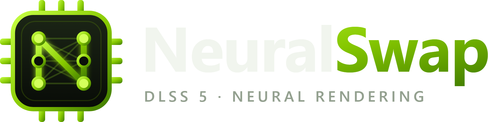

<p align="center"></p>

# NeuralSwap

A native Rust rewrite of [DLSS 5 Swapper](https://github.com/rakanki911/DLSS5-Swapper):
finds your games and installs DLSS 5 Neural Rendering (RenoDX + ReShade) in one
click — and puts every original file back whenever you want.

One ~20 MB executable, GPU-rendered UI (egui/wgpu), no Electron, no browser engine.

## Build

```
cargo build --release
```

The executable is `target\release\NeuralSwap.exe`.

## Install / share

Run **NeuralSwap-Setup.exe** from the latest release. It installs per user to
`%LOCALAPPDATA%\Programs\NeuralSwap` (no administrator rights), adds Start-menu and
desktop shortcuts and an entry in Settings → Apps for uninstalling. The setup is
the app itself with the payload zip appended — no installer framework needed.

## Auto-update (no backend)

The app checks `api.github.com/repos/<owner>/<repo>/releases/latest` of a **public**
repository, reads the release's `update.json`, downloads the new exe (and the payload
zip only if its fingerprint changed), verifies every SHA-256, swaps itself and
restarts. The repository is baked in at build time (`NEURALSWAP_REPO`) and can be
changed in Settings → Updates.

To release:

```
.\scripts\build-release.ps1 -Repo owner/NeuralSwap -Notes "What changed"
```

then create a GitHub release tagged `v<version>` (version from `Cargo.toml`) and
attach the files from `release\`.

With `-NoPayload` the release carries only the app: the public setup is ~20 MB and
the DLSS 5 files are imported after installing (Home or Settings → **Import DLSS 5
files**, from a `NeuralSwap-payload.zip` or a folder; an original DLSS 5 Swapper
install is found automatically). A full setup for private sharing is written to
`release\private\` — never upload that folder. Updates then replace only the app
and keep the local DLSS files.

## Payload

The DLSS 5 files are not compiled in. They live in a `payload` folder found
beside the executable or any parent folder (so `target\release` finds the
project's `payload\`), or wherever **Settings → Payload folder** points:

```
payload\
  streamline\            nvngx_dlss.dll, nvngx_dlssnr.dll, nvngx_dlssg.dll, sl.*.dll
  renodx-dlss5.addon64   native-route RenoDX consumer
  reshade-vulkan\        ReShade64.dll / ReShade32.dll (add-on builds)
  feeder\                DLSS5-Feeder 0.15.1 (hash-verified), VORT shaders,
  feeder\host64\         renodx-dlss5.addon64, renodx-dlss.addon64 (multipass)
  ReShade_Setup_*_Addon.exe
```

An installed copy of the original app (`resources\payload`) has exactly this layout.
`payload\` is git-ignored.

## Routes

| Route | For | What it does |
| --- | --- | --- |
| **Native DLSS (RenoDX)** | 64-bit DX12 games that ship DLSS | Upgrades the game's own `nvngx_dlss.dll` in place (incl. Unreal `ThirdParty` folders), adds `nvngx_dlssnr.dll` + `renodx-dlss5.addon64` beside the exe, deploys ReShade 6.8 add-on build as `dxgi.dll`. Streamline / FG / RR untouched. |
| **RenoDX DLSS Tool (multipass)** | 64-bit DX11/12 | Same shape with ShortFuse's multipass add-on. |
| **DLSS5-Feeder** | 64-bit DX11/12 without (usable) DLSS | Feeder add-on, VORT motion vectors, configured ReShade.ini / preset / `dlss5-feed.cfg`, neural runtime beside the exe. |

32-bit, DX9, Vulkan, OpenGL and emulator routes of the original are not ported yet.

## Safety

- Every write is journaled (`_DLSS5_Backup\pending-switch.json`); a failed or
  interrupted install rolls back to the exact bytes that were there before.
- Originals are backed up to `_DLSS5_Backup\originals\<uuid>\`; **Restore originals**
  puts them back and deletes everything that was added.
- Manifests are byte-compatible with the original Electron app: games installed by
  either tool can be restored by the other.
- Refuses to write outside the game folder, through symlinks/junctions, or over a
  conflicting loader (ENB, DXVK, a second ReShade). Refuses while the game runs.
- **Anti-cheat** (EasyAntiCheat, BattlEye, EA AC) is detected and flagged. Installing
  into such a game needs explicit consent for that single install. Nothing ever
  disables or bypasses anti-cheat — injecting ReShade into an anti-cheat game can
  prevent launch or get an account banned.

## Command line

```
NeuralSwap scan    "<game dir>"
NeuralSwap install "<game dir>" [--route native|renodx|feeder] [--exe <rel>] [--accept-anticheat]
NeuralSwap restore "<game dir>"
NeuralSwap library
NeuralSwap payload
NeuralSwap import-payload <zip or folder>
NeuralSwap pack-release [out dir] [--notes "text"] [--no-payload]
```

Dev flags for the GUI: `--open <name substring>`, `--page home|games|addons|history|settings|about`.

## Layout

| File | Role |
| --- | --- |
| `src/core/pe.rs` | PE reader: imports, delay imports, bitness, version resource, marker search |
| `src/core/scan.rs` | Game scanning, exe selection, API detection, ReShade / anti-cheat detection |
| `src/core/payload.rs` | Payload discovery and Feeder release verification |
| `src/core/journal.rs` | Write-ahead file journal, safe paths, recovery |
| `src/core/apply.rs` | Manifest, native / multipass / Feeder installs, restore |
| `src/core/ini.rs` | Line-preserving INI edits (ReShade.ini, presets, feed cfg) |
| `src/core/guards.rs` | Game-running check, GPU / driver info |
| `src/core/history.rs` | Append-only install history (JSONL) + import from backups |
| `src/library.rs` | Steam, Epic, GOG, Ubisoft and user folders |
| `src/art.rs` | Steam store cover art and details (no account / key) |
| `src/ui/` | egui app: sidebar, pages, game sheet, theme |

Settings, scan cache, artwork and history live in `%APPDATA%\NeuralSwap`.

## Credits

Based on DLSS 5 Swapper by Rakan Alkhaldi (MIT, see `assets/ORIGINAL_LICENSE.txt`).
RenoDX by ShortFuse and contributors, DLSS5-Feeder by jlrouzies-fr, VORT shaders by
vortigern11, ReShade by crosire. NVIDIA DLSS and Streamline © NVIDIA Corporation.
